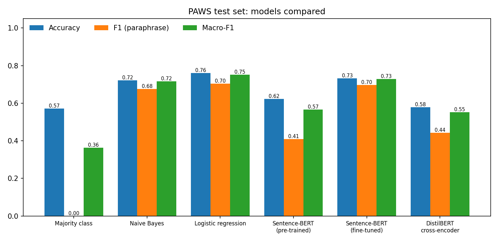

# Paraphrase Detection on PAWS

[](https://github.com/jocelync07/paraphrase-detection/actions/workflows/tests.yml)

Do two sentences mean the same thing? This project compares three approaches on **PAWS**, a dataset built to fool models that only count shared words:

| Pair | Same meaning? |
|---|---|
| *Flights from New York to Florida.* / *Flights from Florida to New York.* | No: same words, swapped roles |
| *The film was directed by X in 1998.* / *In 1998, X directed the film.* | Yes |

1. **Overlap features + Naive Bayes / logistic regression:** 8 hand-made features, including two that measure **word order**.
2. **Siamese Sentence-BERT:** one encoder turns each sentence into a vector, then fine-tuned with a contrastive loss. Used for both **retrieval** and classification.
3. **DistilBERT cross-encoder:** both sentences go through the transformer together, so attention can compare every word pair.

## Results

5,000 training pairs and 1,000 test pairs sampled from PAWS `labeled_final` (seed 42), on a laptop CPU. Full numbers: [`results/results.md`](results/results.md).



| Model | Accuracy | F1 (paraphrase) | Macro-F1 |
|---|---|---|---|
| Majority class (always "not paraphrase") | 0.571 | 0.000 | 0.363 |
| Naive Bayes, 8 overlap features | 0.722 | 0.675 | 0.716 |
| **Logistic regression, same features** | **0.761** | **0.704** | **0.752** |
| Sentence-BERT, pre-trained + threshold | 0.622 | 0.409 | 0.566 |
| Sentence-BERT, fine-tuned + threshold | 0.732 | 0.697 | 0.728 |
| DistilBERT cross-encoder, 3 epochs | 0.579 | 0.442 | 0.552 |

**Retrieval with Sentence-BERT:** each paraphrase's first sentence searches for its partner among all 1,000 test sentences.

| | Recall@1 | Recall@5 | MRR | Similarity gap (paraphrase − not) |
|---|---|---|---|---|
| Pre-trained | 0.753 | 1.000 | 0.866 | 0.010 |
| Fine-tuned (1 epoch) | **0.809** | 1.000 | **0.899** | **0.123** |

### What the results show

- **Word order is the signal.** A plain bag of words can't tell the two sentences in the first example apart: their word overlap is identical. The baselines work because two features measure order: the longest common subsequence, and a Kendall-tau-style "order agreement". With them, a linear model reaches 76% accuracy.
- **Fine-tuning taught Sentence-BERT the difference.** Pre-trained, it gave paraphrases and non-paraphrases almost the same similarity: the gap is just 0.010, because all the sentences are about the same topic. One epoch of contrastive training raised the gap twelve-fold to 0.123. Classification accuracy rose from 62% to 73%, and the true partner was ranked first more often (Recall@1 from 0.75 to 0.81).
- **The cross-encoder needs more than a laptop could give it here.** DistilBERT's training loss only started to drop in epoch 3 (0.69 → 0.56), and test accuracy stayed near the majority baseline. It is the most capable architecture, but learning PAWS's word-swap patterns from scratch takes more data and more epochs than 5,000 pairs on a CPU. Published results use the full 49,000-pair training set on GPUs. The next step is to train it on a free GPU (Google Colab) with the full training set.

## Run it

Needs Python 3.9 or newer. The first run downloads PAWS and two pre-trained models from the Hugging Face Hub.

```bash
pip install torch --index-url https://download.pytorch.org/whl/cpu
pip install -r requirements.txt
python run_all.py                            # full run, about 75 min on a laptop CPU
python run_all.py --train 1000 --test 300    # quick check, a few minutes
pytest -v                                    # fast tests, no downloads
```

## Project structure

```
paraphrase/
  data.py           load and sample PAWS (seeded)
  baseline.py       8 overlap and word-order features; Naive Bayes and logistic regression
  retrieval.py      Siamese Sentence-BERT: contrastive fine-tuning, retrieval and threshold classification
  cross_encoder.py  DistilBERT sentence-pair classifier, plain PyTorch training loop
  metrics.py        accuracy/F1, Recall@k, MRR, threshold selection
run_all.py          trains and evaluates everything; writes results/
tests/              features, metrics and retrieval ranking (no downloads needed)
```

PAWS is by Zhang, Baldridge and He (2019), *PAWS: Paraphrase Adversaries from Word Scrambling*.
